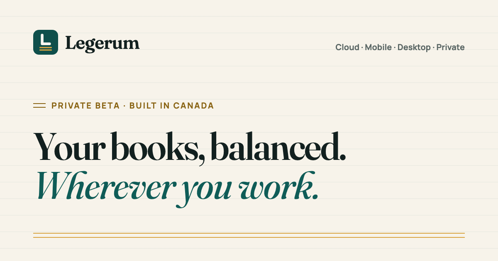

  

# Legerum

**Bookkeeping and accounting for Canadian business.** Invoicing, expenses, bank
reconciliation, payroll and GST/HST in one calm ledger — on the web, on your
phone, on your own servers or fully offline on your desktop.

> [!NOTE]
> Legerum is in **private beta**. [Request access at legerum.ca →](https://legerum.ca/#beta)

## One ledger, four editions

| Edition | Runs on | For |
| --- | --- | --- |
| **Cloud** | Any browser | Sign in from anywhere; updates, backups and security handled for you |
| **Mobile** | iOS · Android | Receipt capture, invoicing and cash on the go |
| **Desktop** | macOS · Windows | Books on your own computer, fully offline |
| **Private** | Self-hosted | Your servers or private cloud, for organizations that keep financial data in-house |

## Built for Canada

- GST/HST, PST and QST applied per transaction, in every province and territory
- Payroll deductions for CPP/QPP, EI and provincial tax, with T4, Relevé 1 and ROE
- Fully bilingual — English and French
- Designed around PIPEDA

---

  
  <a href="https://legerum.ca/">legerum.ca</a> · <a href="https://legerum.ca/fr/">Français</a> ·
  Designed and built in Canada · © <a href="https://kharkevich.com/">Kharkevich Engineering Lab</a>

